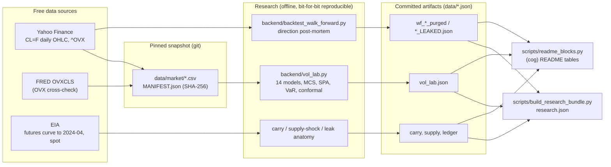
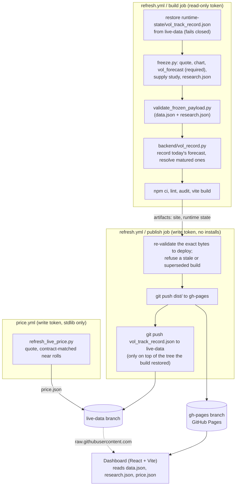

# Architecture

The project runs on free infrastructure only: GitHub Actions computes, GitHub Pages serves a static
site, and two git branches hold everything that changes at runtime. There is no server in
production. The design goals, in order: every published number is reproducible from the
repository; no job that can write to the repository runs third-party code; and a failure keeps the
previous good site live instead of publishing something wrong.

## Research and data flow

`python -m backend.vol_lab` rebuilds `data/vol_lab.json` from the pinned snapshot with no network
access; `.github/workflows/reproduce.yml` does that on every change and checks the result equals the
committed file. `python -m backend.vol_lab --refresh` downloads a new snapshot first.

## Live pipeline and deploy

- **Least privilege.** The build job holds a read-only token and runs every third-party install and
  build tool. The publish job holds the write token, installs nothing, and runs only GitHub's own
  checkout, artifact and Python setup actions, git, and this repository's standard-library scripts.
  `tests/test_workflow_guards.py` enforces this (action allowlist pinned to commit SHAs, no package
  tooling in write-token jobs, no secret except `EIA_API_KEY` in the freeze step).
- **Fail closed.** A failed freeze, a payload that fails validation, a missing or malformed live
  record, or a build superseded by a newer run all stop before anything is published; the previous
  site stays live.
- **The live record** is append-only and committed by the publish job after the site deploys. Each
  forecast is scored on a window that starts after its git commit, so the commit timestamp proves the
  forecast came first (see `backend/vol_record.py`).
- **Cadence.** GitHub runs scheduled workflows on a best-effort basis: the 4-hourly refresh lands
  every 4–12 hours and the 15-minute quote every few hours. The dashboard shows the age of everything
  it displays.

## Code map

| Path | Role |
|---|---|
| `backend/vol_forecast.py` | Model of record (HAR-IV v2): validation, live forecast, interval, economic tests |
| `backend/vol_lab.py` | Benchmark field and evaluation on the pinned snapshot |
| `backend/forecast_eval.py` | Shared statistics (DM, MCS, Mincer-Zarnowitz, VaR tests, conformal) |
| `backend/market_data.py` | Pinned, hash-verified data snapshot |
| `backend/vol_record.py` | Live forward record (stdlib only) |
| `backend/contract_calendar.py` | CME CL calendar: last trade dates, sessions, rolls (stdlib only) |
| `backend/server.py`, `freeze.py` | Payload assembly (Flask test client, frozen to static JSON) |
| `backend/oil.py`, `backend/backtest_walk_forward.py` | Retracted direction model and its walk-forward, kept so the post-mortem reproduces |
| `scripts/validate_frozen_payload.py` | Deploy gate (stdlib only) |
| `scripts/build_research_bundle.py`, `scripts/readme_blocks.py` | research.json and README tables from artifacts |
| `src/` | Dashboard |
| `docs/DATA_CONTRACT.md` | The data.json / research.json schema |
