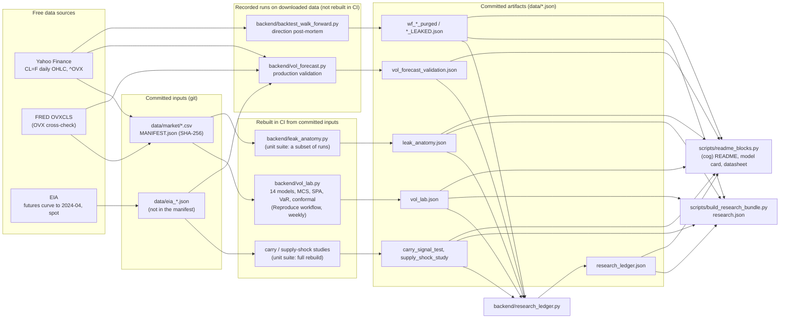
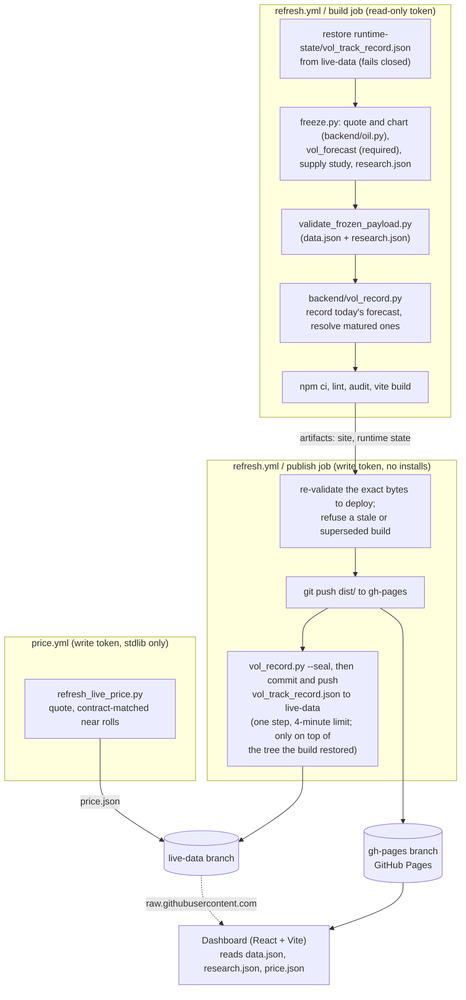

# Architecture

The project runs on free infrastructure only: GitHub Actions computes, GitHub Pages serves a static
site, and two git branches hold everything that changes at runtime. There is no server in
production. The design goals, in order: every research number on the site is copied from a
committed artifact, and the documentation says which artifacts CI rebuilds; the live numbers are
computed at each refresh and validated before they are published; no job that can write to the
repository runs third-party code; and a failure keeps the previous good site live instead of
publishing something wrong.

## Research and data flow

`python -m backend.vol_lab` rebuilds `data/vol_lab.json` from the pinned snapshot with no network
access. `.github/workflows/reproduce.yml` does that on pull requests and pushes that change the
lab's inputs, every week, and on demand, and compares the result with the committed file using
`vol_lab.compare_reports`: every model set, flag, label and count must be identical, and every
number within 1e-4 relative or within one unit of the last decimal it is published with (GARCH
refits differ in the last bits across CPU kernels). `python -m backend.vol_lab --refresh` downloads
a new snapshot first. The unit suite (`tests.yml`) rebuilds the carry and supply-shock studies and
the research ledger and requires them to equal the committed files, and re-runs a subset of the
leak anatomy's runs. The production validation and the post-mortem runs are committed records and
are not regenerated in CI; Yahoo revises history, so a re-run differs in detail.

## Live pipeline and deploy

- **Least privilege.** The build job holds a read-only token and runs every third-party install and
  build tool. The publish job holds the write token, installs nothing, and runs only GitHub's own
  checkout, artifact and Python setup actions, git, and this repository's standard-library scripts.
  `tests/test_workflow_guards.py` enforces this (action allowlist pinned to commit SHAs, no package
  tooling in write-token jobs, no secret except `EIA_API_KEY` in the freeze step).
- **Fail closed.** A failed freeze, a payload that fails validation, a missing or malformed live
  record, a build older than the live site, or a build superseded by a newer run all stop before
  anything is published; the previous site stays live.
- **The live record** is append-only and persisted by the publish job after the site deploys. In
  the persist step, `vol_record.py --seal` stamps `sealed_at` on every entry not yet sealed,
  immediately before the commit and push; the step's four-minute limit keeps the push inside
  `vol_record.SEAL_MARGIN` (five minutes). An entry whose window-opening settlement is not more than
  `SEAL_MARGIN` after its seal, or that was never sealed, is marked `late_commit` and never scored,
  so every scored entry was pushed before the first price it is scored on. Commit dates are set by
  the committer and prove nothing on their own; GitHub's Actions run logs and push events are the
  external record of when each push happened. The site is built before the seal, so it shows a late
  entry as pending until the next run.
- **Cadence.** GitHub runs scheduled workflows on a best-effort basis: the refresh is scheduled
  every 4 hours and the quote every 15 minutes, and either can land late or be skipped. The
  dashboard shows the age of everything it displays.

## Code map

| Path | Role |
|---|---|
| `backend/vol_forecast.py` | Model of record (HAR-IV v2): validation, live forecast, interval, economic tests |
| `backend/vol_lab.py` | Benchmark field and evaluation on the pinned snapshot |
| `backend/forecast_eval.py` | Shared statistics (DM, MCS, Mincer-Zarnowitz, VaR tests, conformal) |
| `backend/market_data.py` | Pinned, hash-verified data snapshot |
| `backend/vol_record.py` | Live forward record, its seal and the promotion test (stdlib only) |
| `backend/contract_calendar.py` | CME CL calendar: last trade dates, sessions, rolls (stdlib only) |
| `backend/oil.py` | The production contract quote and chart history; also the retracted direction model's code |
| `backend/server.py`, `freeze.py` | Payload assembly (Flask test client, frozen to static JSON) |
| `backend/backtest_walk_forward.py` | The purged walk-forward engine the post-mortem runs on (retracted direction model) |
| `backend/leak_anatomy.py`, `backend/carry_signal_test.py`, `backend/supply_shock_playbook.py` | The leak demonstration and the side studies |
| `backend/research_ledger.py` | Every hypothesis tested, with multiplicity adjustments |
| `scripts/validate_frozen_payload.py` | Deploy gate (stdlib only) |
| `scripts/build_research_bundle.py`, `scripts/readme_blocks.py`, `scripts/make_figures.py` | research.json, the generated docs and the figures, from the artifacts |
| `src/` | Dashboard |
| `docs/DATA_CONTRACT.md` | The data.json / research.json schema |
