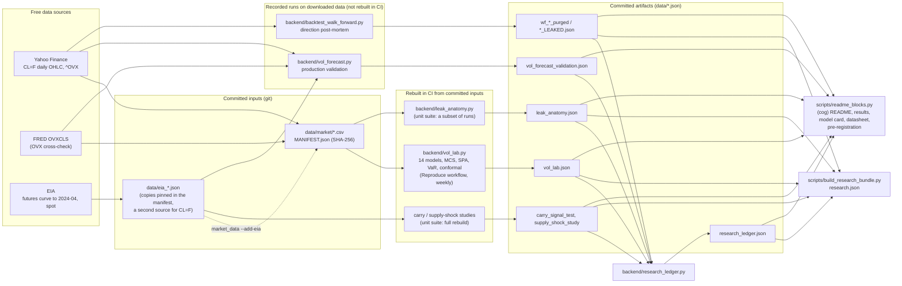
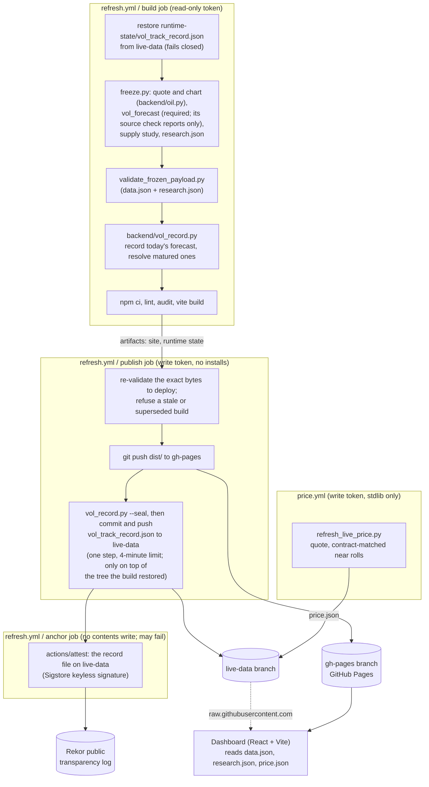

# Architecture

The project runs on free infrastructure only: GitHub Actions computes, GitHub Pages serves a static
site, and two git branches hold everything that changes at runtime. There is no server in
production. The design goals, in order: every research number on the site is copied from a
committed artifact, and the documentation says which artifacts CI rebuilds; the live numbers are
computed at each refresh and validated before they are published; no job that can write to the
repository runs third-party code; and a failure keeps the previous good site live instead of
publishing something wrong.

## Research and data flow

`python -m backend.vol_lab` rebuilds `data/vol_lab.json` from the pinned snapshot with no network
access. `.github/workflows/reproduce.yml` does that on pull requests and pushes that change the
lab's inputs, every week, and on demand, and compares the result with the committed file using
`vol_lab.compare_reports`: every model set, flag, label and count must be identical, and every
number within 1e-4 relative or within one unit of the last decimal it is published with (GARCH
refits differ in the last bits across CPU kernels). Its second job does the same inside the pinned
container (`Dockerfile`: Python and Node images pinned by digest, the repository's own
requirements and lockfile, the workflow's numeric environment; `make reproduce`), so the image a
reviewer builds is checked on the same schedule. `python -m backend.vol_lab --refresh` downloads
a new snapshot first. The unit suite (`tests.yml`) rebuilds the carry and supply-shock studies and
the research ledger and requires them to equal the committed files, and re-runs a subset of the
leak anatomy's runs. The production validation and the post-mortem runs are committed records and
are not regenerated in CI; Yahoo revises history, so a re-run differs in detail.

## Live pipeline and deploy

- **Least privilege.** The build job holds a read-only token and runs every third-party install and
  build tool. The publish job holds the write token, installs nothing, and runs only GitHub's own
  checkout, artifact and Python setup actions, git, and this repository's standard-library scripts.
  The anchor job can sign and store an attestation (`id-token`, `attestations`) but not write the
  repository, and runs only GitHub's checkout and attest actions.
  `tests/test_workflow_guards.py` enforces this (action allowlist pinned to commit SHAs, no package
  tooling in write-token jobs, no secret except `EIA_API_KEY` in the freeze step).
- **Fail closed.** A failed freeze, a payload that fails validation, a missing or malformed live
  record, a build older than the live site, or a build superseded by a newer run all stop before
  anything is published; the previous site stays live.
- **The live record** is append-only and persisted by the publish job after the site deploys. In
  the persist step, `vol_record.py --seal` stamps `sealed_at` on every entry not yet sealed,
  immediately before the commit and push; the step's four-minute limit keeps the push inside
  `vol_record.SEAL_MARGIN` (five minutes). An entry whose window-opening settlement is not more than
  `SEAL_MARGIN` after its seal, or that was never sealed, is marked `late_commit` and never scored,
  so every scored entry was pushed before the first price it is scored on. Commit dates are set by
  the committer and prove nothing on their own; GitHub's Actions run logs and push events are the
  external record of when each push happened. The site is built before the seal, so it shows a late
  entry as pending until the next run. The seal also links each entry it stamps to the sealed part
  of the entry before it (`previous_sha256`, a hash chain); `scripts/verify_record.py`, the Health
  workflow and LIVE report a break, and loading the record never checks it, so a break cannot stop
  the pipeline. The chain has no key and does not cover the newest entry: it shows an edit only
  when the later links were left alone, or against an earlier copy of the record. After publish,
  the anchor job attests the record file as it then is on `live-data` (best effort), which logs its
  SHA-256 in Sigstore's public Rekor log with Rekor's own time; `scripts/verify_anchors.py` reads
  those times back for each sealed entry. It runs after the seal, never inside its step, and
  `continue-on-error` keeps a Sigstore outage from failing a refresh; while it runs it holds the
  workflow's concurrency group, so a slow anchor can hold the next queued refresh for at most its
  five-minute timeout.
- **Cadence.** GitHub runs scheduled workflows on a best-effort basis: the refresh is scheduled
  every 4 hours and the quote every 15 minutes, and either can land late or be skipped. The
  dashboard dates what it displays rather than assuming a cadence: the top bar gives the snapshot's
  age and turns amber once a refresh is overdue, the quote carries its exchange time, and each
  section names its sample.
- **Failures announce themselves.** `.github/workflows/health.yml` runs daily and after every
  Refresh and Reproduce run on main (never for a pull request's run). `scripts/record_health.py`
  reads copies of the record on `live-data` and of `data.json` on `gh-pages`, fetched with `gh`,
  and the latest runs. Needing a person: a due session with no entry that can still be recorded, an
  overdue result, a site more than 18 hours old, two failed refreshes in a row, a failed rebuild, or
  an unreadable record or payload. Recorded incidents, which nothing can undo: a session that can no
  longer be recorded, a `late_commit` or `expired` entry, and a day on which a Refresh run's
  best-effort anchor job failed (read from the runs' job lists, since `continue-on-error` keeps
  those runs green), each for a week. Source checks: what the freeze's report-only check of the live
  `CL=F` closes found (`vol_forecast.source_check`: sessions that differ from the pinned snapshot,
  a gross gap from EIA spot, a spot series too old to check against), listed while the deployed
  `data.json` reports it. While anything is
  reported, one issue labelled `health` stays open, edited only when the set of problems changes;
  closing it acknowledges the incidents. The workflow fails (its README badge turns red) only while
  something needs a person, and the first healthy run closes the issue. A drill (the `now` input)
  writes only the job summary. The job can write issues only, installs nothing, and never pushes or
  seals (`tests/test_workflow_guards.py`).

## Code map

| Path | Role |
|---|---|
| `backend/vol_forecast.py` | Model of record (HAR-IV v2): validation, live forecast, interval, economic tests |
| `backend/vol_lab.py` | Benchmark field and evaluation on the pinned snapshot |
| `backend/forecast_eval.py` | Shared statistics (DM, MCS, Mincer-Zarnowitz, VaR tests, conformal) |
| `backend/market_data.py` | Pinned, hash-verified data snapshot |
| `backend/vol_record.py` | Live forward record, its seal and the promotion test (stdlib only) |
| `backend/contract_calendar.py` | CME CL calendar: last trade dates, sessions, rolls (stdlib only) |
| `backend/oil.py` | The production contract quote and chart history; also the retracted direction model's code |
| `backend/server.py`, `freeze.py` | Payload assembly (Flask test client, frozen to static JSON) |
| `backend/backtest_walk_forward.py` | The purged walk-forward engine the post-mortem runs on (retracted direction model) |
| `backend/leak_anatomy.py`, `backend/carry_signal_test.py`, `backend/supply_shock_playbook.py` | The leak demonstration and the side studies |
| `backend/research_ledger.py` | Every hypothesis tested, with multiplicity adjustments |
| `scripts/validate_frozen_payload.py` | Deploy gate (stdlib only) |
| `scripts/record_health.py` | The Health workflow's check of the record, the site and the last runs (stdlib only) |
| `scripts/verify_record.py`, `scripts/verify_anchors.py` | A reviewer's checks of the sealed record, from the file alone and against the Rekor log (stdlib only) |
| `scripts/build_research_bundle.py`, `scripts/readme_blocks.py`, `scripts/make_figures.py` | research.json, the generated docs and the figures, from the artifacts |
| `Dockerfile`, `Makefile`, `.devcontainer/` | The pinned reproduce environment and one target per check |
| `src/` | Dashboard (below) |
| `docs/DATA_CONTRACT.md` | The data.json / research.json schema |

## Dashboard

A static React app built by Vite. It fetches `data.json` and `research.json` from its own origin in
parallel, and the quote from both `live-data` and the deploy's own `price.json`, keeping the newest
usable one. `research.json` is optional: without it the sections that need it say so and a notice
offers Retry. Every figure is code-split; it mounts when it nears the screen or, once the page has
settled, in the background one at a time, and printing mounts them all.

| Path | Role |
|---|---|
| `src/app/` | Shell (top bar, footer), data hooks, the section registry (`sections.js`), view state in the URL (`viewState.js`), the jump palette's commands and keyboard shortcuts |
| `src/panels/` | The verdict lede, this week's call, the tiles, the evidence index and the market strip; one panel per section |
| `src/lib/` | Formatting, the computed headlines and claims (`assertions.js`, `research.js`, `verdict.js`, `tiles.js`), the glossary, CSV export, print |
| `src/charts/` | Canvas charts on lightweight-charts (forecast, VaR, price) and SVG charts on d3-scale and d3-shape |
| `src/components/` | Shared pieces: the panel frame (method notes, source and reproduce lines), tables with CSV export, the palette, glossary terms |
| `src/theme/`, `src/styles/` | Design tokens (mirrored for canvas in `chartTheme.js`; a test keeps the two equal) and stylesheets |
| `tests/frontend/` | `node --test` suites; `render.test.mjs` server-renders the page against `tests/fixtures/` |
