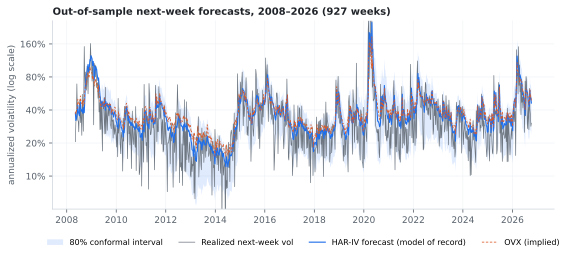
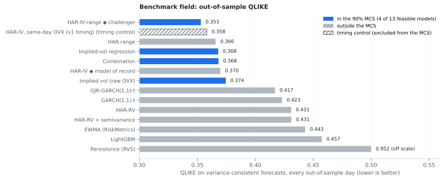
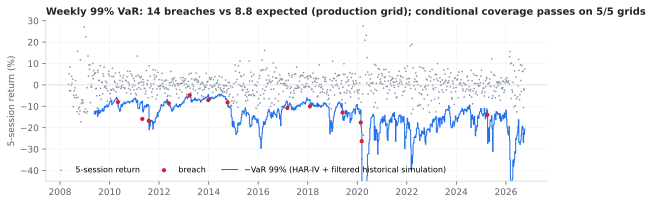
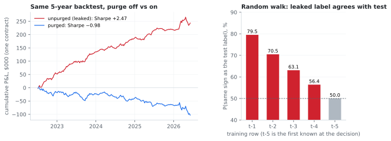
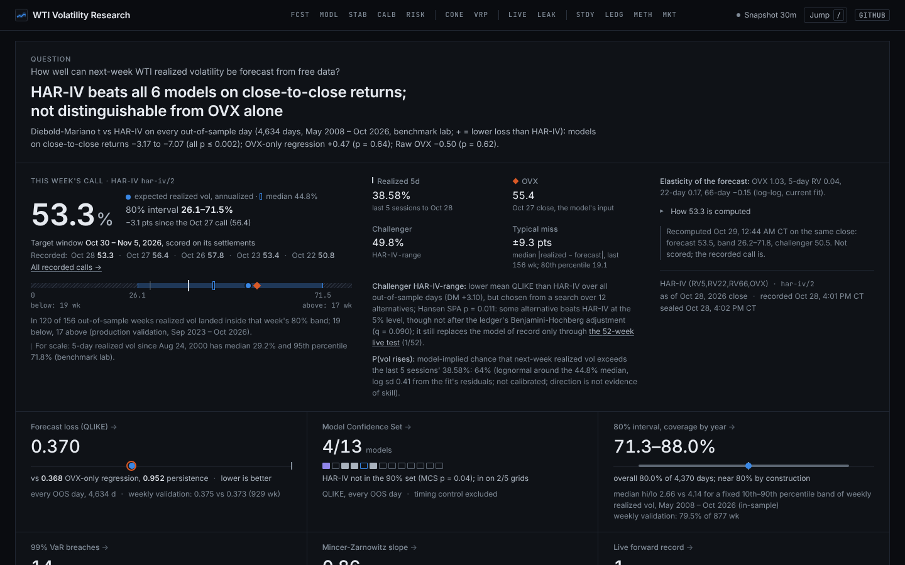

# Forecasting WTI Crude Oil Volatility with Free Data: the full results

The complete write-up: design, every result with its test, the live record's rules, the post-mortem
of the retracted direction model, the side studies, the research ledger, how to reproduce, the system
and the limitations. The [README](../README.md) is the short version, and the
[reviewer guide](REVIEWER_GUIDE.md) says how to check the main claims in about ten minutes.



*Figure 1. Out-of-sample forecasts of the model of record (blue) with its 80% adaptive conformal
interval, realized next-week volatility (grey) and the OVX implied-volatility index (orange), on the
production weekly grid (every fifth session). Log scale; the axis spans every plotted value.*

## Abstract

<!-- [[[cog import scripts.readme_blocks as b; b.print_block("abstract") ]]] -->

This project forecasts the realized volatility of front-month NYMEX WTI crude oil over the next five sessions from free data, and keeps a public forward record of its live forecasts that scores only entries sealed in git before the settlement that opens their window. Over 4,634 out-of-sample days (2008–2026), a heterogeneous autoregressive model with lagged implied volatility (HAR-IV, the model of record) has a QLIKE loss of 0.370, against 0.952 for a random-walk forecast. It is significantly better than GJR-GARCH(1,1)-t, GARCH(1,1)-t, HAR-RV, HAR-RV + downside semivol, EWMA (RiskMetrics) and LightGBM (Diebold-Mariano p < 0.05 each). The elasticity on OVX is 1.03, and the OVX-only regression, a log regression on OVX alone (0.368, DM p = 0.641), is statistically tied with the full model. HAR-range, from daily price ranges without OVX, is also statistically tied with the model of record (QLIKE 0.366, DM p = 0.629), so these data do not show that OVX is needed to reach its loss.

Of the 13 models that use only information available at the decision, the 90% Model Confidence Set keeps 4 (HAR-IV-range, Combination, OVX-only regression and Raw OVX); the 14th, a timing control that reads OVX after the decision, is excluded. The model of record is outside it (MCS p = 0.037), and inside it on 2 of the 5 non-overlapping sampling grids. HAR-IV-range, a range-based variant of the model of record, has the lowest loss of all 14 models (0.353, pairwise DM p = 0.002) and is in the set over the full sample and on all 5 grids. Hansen's SPA test, which accounts for the search over the field, rejects the null that no model beats the model of record (studentized p = 0.011), though the rejection does not survive the ledger's Benjamini-Hochberg adjustment across the 75 hypotheses in its multiplicity family (q = 0.090); the variant runs live as a challenger, and replaces the model of record only under a promotion test fixed in advance.

The model of record's 80% adaptive conformal intervals cover 80.0% of outcomes (the method steers long-run coverage to its target), and its weekly 99% Value-at-Risk breaches 14 times against 8.8 expected on the production grid, with breaches that pass the independence test on 5/5 grids against 1/5 for historical simulation; a VaR scaled by raw OVX, with nothing fitted, passes on 5/5 too, so that gain comes from scaling by volatility and is not specific to this model. In the production validation (a recorded run on downloaded data), sizing a 35% volatility target on the forecast over 800 weeks gives a realized volatility of 34.9% and an excess kurtosis of 1.82 (buy-and-hold: 58.18), and does not change the Sharpe ratio detectably (difference −0.12 vs buy-and-hold, p = 0.408). Sizing on trailing 22-day volatility, with no forecast, gives 38.0% and 1.96, so most of that risk control comes from scaling by volatility at all; between the two sized books only the Sharpe difference is tested (+0.01, p = 0.764). Next-week volatility-direction accuracy (whether next week's realized volatility exceeds this week's: 74.4% on the production grid) is not evidence of skill: the same pipeline, run as HAR without OVX on simulated i.i.d. returns with nothing to forecast, scores 75.2%. OVX is above the next month's realized volatility in 73.5% of periods, which is not evidence of a variance risk premium: with no premium, a noisy, right-skewed 20-session realized volatility would be below OVX in 69.5% of periods (one-sided p = 0.318 for the difference), and the premium in variance units, the relevant measure, is not significant.

The project began as a machine-learning direction model whose backtest Sharpe ratio of 2.47 after costs was a look-ahead leak; purged, it is −0.98. The same leak gives a 20-tree random forest a gross (before costs) Sharpe ratio of 2.85 on a pure random walk. All 76 hypotheses the project has tested are listed in a research ledger with multiplicity adjustments: of the 18 supported ones in the adjusted family, 8 survive Benjamini-Hochberg at 5%; 44 are not supported (a failure to reject, not evidence against them) and 9 are retracted. The challenger's pairwise test is left out of that family, because the challenger was picked by searching the field on the same sample; the SPA test is its search-adjusted counterpart.
<!-- [[[end]]] -->

## Results at a glance

<!-- [[[cog import scripts.readme_blocks as b; b.print_block("results_at_a_glance") ]]] -->

| Question | Answer | Evidence | Source |
|---|---|---|---|
| Is next-week WTI volatility forecastable from free data? | Yes | QLIKE 0.370 vs 0.952 for persistence (DM p < 0.001); 7 of the 12 feasible benchmarks significantly worse | lab |
| Does it add to implied volatility? | Not detectably | OVX-only regression 0.368 (DM p = 0.641), Raw OVX 0.374 (DM p = 0.620); OVX elasticity 1.03 (HAC t 13.2) | lab |
| Is anything better? | In sample, after the search: HAR-IV-range; the live test decides | HAR-IV-range QLIKE 0.353 (pairwise DM p = 0.002, before the search is accounted for); model of record outside the 90% MCS (p = 0.037); SPA p = 0.011 after the search (not after the ledger's Benjamini-Hochberg adjustment, q = 0.090); challenger on the live record | lab |
| Are the forecasts calibrated? | Unbiasedness not rejected | Mincer-Zarnowitz slope 0.86 (joint p = 0.161); 80% intervals cover 80.0% (adaptive conformal: on target by construction) | lab |
| Does it make a better weekly VaR? | Better than no volatility model, but so is raw OVX: the gain is from volatility scaling | Breach independence passes on 5/5 grids at 95% and 5/5 at 99%, vs 0/5 and 1/5 for historical simulation and 5/5 and 5/5 for raw OVX scaling; 99%: 14 breaches vs 8.8 expected on the production grid (Kupiec passes 5/5) | lab |
| Does it make money as a vol target? | No; volatility scaling controls risk | Sharpe difference vs buy-and-hold −0.12 (p = 0.408), vs trailing-vol sizing +0.01 (p = 0.764); excess kurtosis 1.82, against 1.96 sized on trailing vol (difference not tested) and 58.18 for buy-and-hold | production run |
| Is there a variance risk premium? | Not established: in vol points, not significantly above what a zero premium gives; in variance, not significant; as a short vol-swap return, inconclusive | IV above next-month RV in 73.5% of periods, vs 69.5% expected with zero premium (one-sided bootstrap p = 0.318); mean variance premium −263 (95% CI −1083 to 556); short vol-swap Sharpe 0.52 (one-sided p = 0.070 against a zero mean, though with no premium the vol-point gap would still average 1.5) | production run |
| Is volatility-direction accuracy evidence of skill? | No | 74.4% observed vs 75.2% for HAR without OVX on simulated returns with nothing to forecast | production run |
| Was the original direction model's Sharpe real? | No, a look-ahead leak | Leaked label agrees in sign with the test label 79.52% of the time on a random walk; purged, the Sharpe ratio is −0.98 | leak anatomy; recorded runs |

Source: *lab*: `data/vol_lab.json`, rebuilt from the pinned snapshot and checked in CI. *production run*: `data/vol_forecast_validation.json`, a recorded run on data downloaded from Yahoo Finance and FRED, not rebuilt in CI (Yahoo revises history). *leak anatomy*: `data/leak_anatomy.json`, offline from the pinned snapshot and synthetic returns (the unit suite re-runs a subset). *recorded runs*: the direction post-mortem's `data/wf_*.json`, also runs on downloaded data.
<!-- [[[end]]] -->

Every table, result statistic and data-dependent verdict on this page is generated from the
committed artifacts in [`data/`](../data) by [`scripts/readme_blocks.py`](../scripts/readme_blocks.py),
and CI fails if the page and the artifacts disagree (`cog --check`). Descriptive facts about the
design (the number of models, schedules, time limits) are written by hand. The check is about
consistency, not reproduction, and reproduction differs by artifact:

- **Rebuilt in CI from committed inputs.** `data/vol_lab.json`, the benchmark field, is rebuilt in
  full from a hash-pinned snapshot of the Yahoo and FRED data by the Reproduce workflow, on every
  change to its inputs and every week. The unit suite, on every pull request, rebuilds the carry and
  supply-shock studies from committed EIA files and requires them to equal the committed artifacts,
  re-runs a subset of the leak anatomy's runs, and rebuilds the research ledger.
- **Records of runs on downloaded data.** The production validation
  (`data/vol_forecast_validation.json`: the direction, overlay, variance-risk-premium and
  weekly-grid calibration figures) and the direction post-mortem (`data/wf_*.json`). Yahoo revises
  history, so a re-run gives close but not identical numbers, and CI does not regenerate them.

Each table below names its source.

---

## 1. Question and design

How well can the realized volatility of the front-month contract over the next five sessions be
forecast at the settlement that opens those sessions, using only data that is free and public at
that moment? The project forecasts volatility rather than price direction for a reason. Its first
model forecast direction, and that model's apparent skill turned out to be a look-ahead leak
(section 4). Volatility clustering, by contrast, is one of the best-replicated effects in finance.

<!-- [[[cog import scripts.readme_blocks as b; b.print_block("design_block") ]]] -->

- **Target.** Annualized realized volatility of the next 5 settlement-to-settlement log returns of `CL=F`, the front-month NYMEX WTI future.
- **Decision time.** The 14:30 ET settlement that opens the target window. Every input is published by then; OVX, which settles at 16:15 ET, enters with a 1-session lag, and the test day's own high and low (which run to 17:00 ET) never enter a feature.
- **Walk-forward.** Expanding window from the first 250 rows, with a forecast on every out-of-sample day. The log regressions are refit every day; GARCH and GJR-GARCH are re-estimated weekly and filtered daily; LightGBM is retrained every 13 weeks. For every model trained on targets, the last 4 training rows are purged, because their targets overlap the test target and are not known at the decision.
- **Sample.** 4,634 out-of-sample days, 2008-05-08 to 2026-10-12. Losses and tests use every day. Each of the five 5-session sampling grids (offsets 0–4, 926 or 927 non-overlapping weeks each; grid 0 is the production validator's) is also scored on its own, and VaR is scored only there, since it needs independent outcomes.
- **Forecasts.** Losses, VaR and risk use the variance-consistent forecast (the median times a Duan smearing factor). The direction call and the intervals use the median.
- **Inference.** Model Confidence Set at 90% (range statistic, 5,000 stationary-bootstrap replications, blocks of 20 days or 10 weeks, seed 20261020); Diebold-Mariano with Newey-West variance and the Harvey-Leybourne-Newbold correction; Hansen's SPA against the model of record. The timing control `har_iv_sameday` reads the test day's own OVX close, published after the decision; it is reported but excluded from every Model Confidence Set, the SPA test, the out-of-sample model selection and the choice of challenger.
<!-- [[[end]]] -->

**Data.** Daily `CL=F` open, high, low and close and the Cboe Crude Oil ETF Volatility Index (OVX) from
Yahoo Finance, with OVX cross-checked against FRED. Same-contract returns come from EIA's
futures-curve history, and the supply-shock study uses EIA's Cushing spot price. The benchmark
field runs on a frozen copy of the Yahoo and FRED market data whose SHA-256 digests are pinned
([datasheet](DATASHEET.md#composition)); the EIA files are committed separately and are not
part of that manifest.

**The field.** Fourteen forecasters, from the simplest to the most flexible:
- persistence (last week's realized volatility);
- raw OVX: the previous session's OVX used directly as the forecast;
- RiskMetrics EWMA on all returns since 2000;
- GARCH(1,1) and GJR-GARCH(1,1) with Student-t errors, re-estimated weekly and filtered daily on
  all returns since 2000;
- HAR-RV on close-to-close realized volatility (Corsi 2009), and HAR-RV plus one five-session
  downside semivolatility term (after Patton and Sheppard 2015);
- HAR on a range-based variance (Rogers and Satchell 1991, plus the overnight return), with the
  test day's own bar taken only up to its settlement;
- the OVX-only regression: a log regression on the previous session's OVX alone;
- HAR-IV, the model of record: HAR-RV plus the log of the previous session's OVX;
- HAR-IV-range, the same model on the range-based variance;
- HAR-IV with same-day OVX, a timing control that uses information not available at the decision;
- LightGBM on the HAR, OVX, range-based and semivolatility features;
- an equal-weight combination of the variances of HAR-IV, GJR-GARCH and the OVX-only regression.

Every model forecasts the same target on the same out-of-sample days from information available at
the decision, the timing control excepted, and every model trained on targets drops the same
overlapping training rows. How often each model is refit differs (above). The full specifications
are in the [methodology](METHODOLOGY.md#3-models-backendvol_labpy).

## 2. Results

### 2.1 The benchmark field



*Figure 2. Out-of-sample QLIKE of each forecaster over every day. Blue: in the 90% Model Confidence
Set of the feasible models; grey: outside it; hatched: the timing control, which uses information
published after the decision and is excluded from the set.*

<!-- [[[cog import scripts.readme_blocks as b; b.print_block("leaderboard_table") ]]] -->

| Model | Family | QLIKE | DM vs model of record (p) | DM range over the 5 sampling grids | MCS p | In 90% MCS (grids) | Realized utility (% / yr) |
|---|---|---:|---:|---:|---:|---:|---:|
| **HAR-IV-range** *(challenger)* | HAR | 0.353 | +3.10 (0.002) | +2.30 to +3.19 | 1.00 | yes (5/5) | 3.30 |
| HAR-IV, same-day OVX (v1 timing) | HAR | 0.358 | +3.99 (< 0.001) | +0.86 to +3.06 | — | excluded: timing control | 3.28 |
| HAR-range | HAR | 0.366 | +0.48 (0.629) | −0.20 to +0.86 | 0.06 | no (3/5) | 3.28 |
| OVX-only regression | implied | 0.368 | +0.47 (0.641) | +0.09 to +0.60 | 0.12 | yes (5/5) | 3.26 |
| Combination | combination | 0.368 | +0.41 (0.684) | −0.13 to +1.21 | 0.12 | yes (5/5) | 3.26 |
| **HAR-IV (model of record)** | HAR | 0.370 | — | — | 0.04 | no (2/5) | 3.25 |
| Raw OVX | implied | 0.374 | −0.50 (0.620) | −0.65 to −0.39 | 0.12 | yes (5/5) | 3.29 |
| GJR-GARCH(1,1)-t | time-series | 0.417 | −3.17 (0.002) | −3.10 to −2.13 | 0.00 | no (0/5) | 3.15 |
| GARCH(1,1)-t | time-series | 0.423 | −3.72 (< 0.001) | −3.45 to −2.79 | 0.00 | no (0/5) | 3.13 |
| HAR-RV | HAR | 0.431 | −4.12 (< 0.001) | −4.33 to −3.21 | 0.00 | no (0/5) | 3.11 |
| HAR-RV + downside semivol | HAR | 0.431 | −4.00 (< 0.001) | −4.06 to −3.22 | 0.00 | no (0/5) | 3.11 |
| EWMA (RiskMetrics) | time-series | 0.443 | −4.30 (< 0.001) | −3.86 to −3.30 | 0.00 | no (0/5) | 3.06 |
| LightGBM | machine learning | 0.457 | −5.61 (< 0.001) | −4.66 to −3.34 | 0.00 | no (0/5) | 3.08 |
| Persistence (RV5) | naive | 0.952 | −7.07 (< 0.001) | −5.72 to −4.43 | 0.00 | no (0/5) | 1.51 |

QLIKE on variance-consistent forecasts over every out-of-sample day; DM = Diebold-Mariano (Newey-West, Harvey-Leybourne-Newbold), positive = better than the model of record; MCS = Hansen-Lunde-Nason Model Confidence Set over the 13 feasible models (range statistic, stationary bootstrap, block 20 days). HAR-IV, same-day OVX (v1 timing) is a timing control: it reads the test day's OVX close (16:15 ET), published after the 14:30 ET decision, so it keeps its losses and DM tests but is excluded from every Model Confidence Set, the SPA test, the out-of-sample selection and the choice of challenger. Hansen's SPA test (studentized) of the null that no model beats the model of record, over the 12 feasible alternatives: p = 0.011, read with the ledger's Benjamini-Hochberg result in section 2.1. Realized utility: Bollerslev, Hood, Huss and Pedersen (2018), maximum 4.0. Source: lab.
<!-- [[[end]]] -->

<!-- [[[cog import scripts.readme_blocks as b; b.print_block("field_findings") ]]] -->

The 90% Model Confidence Set keeps 4 of the 13 feasible models (HAR-IV-range, Combination, OVX-only regression and Raw OVX), and every one of them uses implied volatility (HAR-IV-range also uses the daily range). The model of record is outside it (MCS p = 0.037; the ledger counts this as supported, but it does not survive the Benjamini-Hochberg adjustment) and is inside it on 2 of the 5 sampling grids. Every forecaster built from close-to-close returns alone (GJR-GARCH(1,1)-t, GARCH(1,1)-t, HAR-RV, HAR-RV + downside semivol, EWMA (RiskMetrics) and Persistence (RV5)) is significantly worse than the model of record (DM p < 0.05 each). So is LightGBM (DM p < 0.001), although it is given every input the HAR models use: the HAR terms, OVX, the range-based terms and the downside semivolatility. The model of record and the OVX-only regression are statistically indistinguishable (p = 0.641): the realized-volatility terms add nothing detectable to OVX alone.

HAR-IV-range has the lowest QLIKE and the highest realized utility in the field, and beats the model of record on both in a pairwise test (DM p = 0.002 on QLIKE, p = 0.002 on utility). On MSE, which a few extreme weeks dominate, nothing is distinguishable: the MSE confidence set keeps all 13 feasible models, and the challenger's MSE difference from the model of record has DM p = 0.702. The variant was found by searching this sample, and those pairwise p-values do not account for the search. Hansen's SPA test does: after the search the null that no alternative beats the model of record is rejected at 5% (studentized p = 0.011; HAR-IV-range has the largest studentized gain, t 2.91), though the rejection does not survive the ledger's Benjamini-Hochberg adjustment across the 75 hypotheses in its multiplicity family (q = 0.090). Without studentizing (White's Reality Check with Hansen's recentring, the figure published before this correction; see the changelog's errata) the same draws give p = 0.072: on raw means the alternatives whose loss differences vary most set the bootstrap maximum. The studentized p-value is 0.005 with blocks of 10 days and 0.013 with blocks of 40 days (block 20 above); by sub-period it is 0.027 over 2008–2016 (2,177 days; largest gain Combination) and 0.026 over 2017–2026 (2,457 days; largest gain HAR-IV-range). The test accounts for the search within the field, not for how the field was assembled, and every reading is of this sample. That is why the variant competes live rather than replacing the model of record on its historical record.
<!-- [[[end]]] -->

### 2.2 What the model is

<!-- [[[cog import scripts.readme_blocks as b; b.print_block("coefficients_table") ]]] -->

| Term | Coefficient | HAC t |
|---|---:|---:|
| const | −4.876 | −14.07 |
| log RV5 | +0.039 | +1.31 |
| log RV22 | +0.172 | +2.75 |
| log RV66 | −0.152 | −2.89 |
| log OVX | +1.033 | +13.16 |

Full-sample fit of the model of record: 4,884 daily rows, R² 0.486 on log realized vol, Newey-West t with 10 lags (the five-session targets overlap). Units: realized volatility annualized as a decimal, OVX in index points. Source: lab.
<!-- [[[end]]] -->

<!-- [[[cog import scripts.readme_blocks as b; b.print_block("coefficients_reading") ]]] -->

The OVX elasticity is 1.03 (HAC t 13.2). Of the realized-volatility terms, log RV22 (+0.172, t +2.75) and log RV66 (−0.152, t −2.89) are significant at 5% and log RV5 (+0.039, t +1.31) is not. The significant pair has opposite signs and nearly offsets (the three realized coefficients sum to +0.059), so the realized terms enter mainly as the slope between the past month's and the past quarter's volatility, not as a level. Most of the constant is a change of units: OVX enters in index points and realized volatility as a decimal, which accounts for −4.758 of the −4.876; with OVX as a decimal the constant is −0.118. Used directly, OVX is above realized volatility in vol units: realized averages 0.865 times the previous session's OVX. That gap does not measure the variance risk premium. A five-session realized volatility is a noisy estimate, and its mean is below the square root of its expected variance (Jensen's inequality), so a forecast that is right in variance is too high in vol units. The model of record gives a measure of that effect: Mincer-Zarnowitz does not reject that its variance forecast is unbiased (p = 0.161), yet realized averages 0.920 times it: in logs, more than half of OVX's gap. The rest is OVX's level against the front-month future: a 30-calendar-day horizon rather than five sessions, its basis to the future (section 9) and whatever premium it carries (section 2.5). In variance units, the units of the target and of QLIKE, the gap has no stable sign: over the 927 weeks of the production grid, mean realized variance is 1.15 times the mean squared lagged OVX, and 0.93 without 2020. In the log regression the constant and the realized terms absorb the gap, and the smearing factor (section 1, Forecasts) returns the forecast to the variance scale.
<!-- [[[end]]] -->

### 2.3 Calibration and intervals

<!-- [[[cog import scripts.readme_blocks as b; b.print_block("calibration_block") ]]] -->

| Model, sample | MZ intercept | MZ slope (SE) | Joint p (unbiased) | Actual / forecast | 80% coverage | Coverage by year (min to max) | Interval score |
|---|---:|---:|---:|---:|---:|---|---:|
| HAR-IV (model of record), every day | +0.038 | 0.86 (0.14) | 0.161 | 0.920 | 80.0% | 71.3% to 88.0% | 54.45 |
| HAR-IV-range, every day | +0.039 | 0.81 (0.17) | 0.142 | 0.917 | 80.0% | 72.5% to 88.0% | 53.12 |
| HAR-IV, production weekly grid (927 weeks; production run) | −0.026 | 1.22 (0.20) | 0.543 | 0.919 | — | — | — |

Mincer-Zarnowitz regression of realized on forecast variance with a HAC covariance. Intervals: adaptive conformal inference (Gibbs and Candès 2021) with 5-session delayed feedback, step 0.005, scored only after each target has settled; interval score of Gneiting and Raftery (2007), in vol points (lower is better). The every-day rows are from the lab; the production-grid row is from `data/vol_forecast_validation.json`, a recorded run on downloaded data.
<!-- [[[end]]] -->

<!-- [[[cog import scripts.readme_blocks as b; b.print_block("calibration_reading") ]]] -->

No sample rejects unbiasedness at 5% (joint p 0.161, 0.142, 0.543). The model of record's slope is unstable: it is below one on the every-day sample (0.86) and above one on the production weekly grid (1.22). A regression on variances is dominated by a few extreme weeks, and the two samples catch different ones. The model of record's intervals cover 80.0% of the 4,370 scored days against a target of 80%. Adaptive conformal inference steers long-run coverage to its target whatever the model, so that figure checks the method; the yearly coverage and the interval score are what differ between models. Coverage by calendar year ranges 71.3% to 88.0%; with about fifty independent weeks a year, one year's coverage has a standard error of about 6 points, so deviations of that size are expected.
<!-- [[[end]]] -->

### 2.4 Use as a risk input



*Figure 3. Weekly 99% Value-at-Risk from the model of record with filtered historical simulation,
against realized five-session log returns (production grid). Red: breaches.*

<!-- [[[cog import scripts.readme_blocks as b; b.print_block("var_table") ]]] -->

| Method | Level | Exceedances by grid (expected on grid 0) | Kupiec | Independence | Cond. coverage | DQ |
|---|---:|---|---:|---:|---:|---:|
| HAR-IV (model of record) + filtered HS | 5% | 46, 47, 39, 43, 43 (43.8) | 5/5 | 5/5 | 5/5 | 5/5 |
| HAR-IV-range + filtered HS | 5% | 49, 52, 49, 47, 44 (43.8) | 5/5 | 2/5 | 4/5 | 4/5 |
| GJR-GARCH(1,1)-t + filtered HS | 5% | 53, 46, 43, 47, 46 (43.8) | 5/5 | 4/5 | 5/5 | 5/5 |
| EWMA (RiskMetrics) + filtered HS | 5% | 48, 43, 45, 53, 41 (43.8) | 5/5 | 4/5 | 5/5 | 5/5 |
| Raw OVX + filtered HS | 5% | 47, 47, 38, 43, 45 (43.8) | 5/5 | 5/5 | 5/5 | 5/5 |
| Historical simulation (no vol model) | 5% | 49, 54, 44, 46, 46 (43.8) | 5/5 | 0/5 | 0/5 | 0/5 |
| HAR-IV (model of record) + filtered HS | 1% | 14, 12, 13, 12, 9 (8.8) | 5/5 | 5/5 | 5/5 | 5/5 |
| HAR-IV-range + filtered HS | 1% | 14, 13, 13, 14, 9 (8.8) | 5/5 | 5/5 | 5/5 | 5/5 |
| GJR-GARCH(1,1)-t + filtered HS | 1% | 14, 8, 12, 13, 12 (8.8) | 5/5 | 5/5 | 5/5 | 5/5 |
| EWMA (RiskMetrics) + filtered HS | 1% | 15, 11, 12, 13, 11 (8.8) | 5/5 | 5/5 | 5/5 | 4/5 |
| Raw OVX + filtered HS | 1% | 15, 11, 10, 11, 9 (8.8) | 5/5 | 5/5 | 5/5 | 5/5 |
| Historical simulation (no vol model) | 1% | 18, 15, 13, 15, 15 (8.8) | 4/5 | 1/5 | 1/5 | 0/5 |

Weekly (5-session) VaR of a long front-month position, scored on each of the five 5-session sampling grids (non-overlapping outcomes); a test passes at 5%. Kupiec (1995) unconditional coverage, Christoffersen (1998) independence and conditional coverage, Engle-Manganelli (2004) DQ. Source: lab.
<!-- [[[end]]] -->

<!-- [[[cog import scripts.readme_blocks as b; b.print_block("var_reading") ]]] -->

Historical simulation, with no volatility model, passes Kupiec's coverage test on 5/5 grids at 95% and 4/5 at 99%; at 99% it breaches 13 to 18 times per grid against 8.8 expected. Its breaches cluster: it passes the independence test on 0/5 grids at 95% and 1/5 at 99%. Scaling by a volatility forecast removes most of the clustering: with HAR-IV (model of record) and Raw OVX the breaches pass the independence test on every grid at both levels; the other scaled methods pass on fewer grids (at 95%, HAR-IV-range 2/5, GJR-GARCH(1,1)-t 4/5 and EWMA (RiskMetrics) 4/5). Raw OVX, with nothing fitted, does as well as the model of record here, so these pass counts show what scaling by volatility does; they do not rank the forecasts, and no test here compares the scaled methods' VaR losses directly. At 99% the scaled methods breach more often than nominal on 24 of 25 grid-method pairs, and Kupiec's test passes on 25 of 25: the empirical quantile of past standardized outcomes tends to understate the 1% tail that followed.
<!-- [[[end]]] -->

A long position scaled to a constant volatility target is the use a risk desk would make of the
forecast. The production validation measures it on same-contract returns:

<!-- [[[cog import scripts.readme_blocks as b; b.print_block("overlay_table") ]]] -->

| Book | Sharpe | Realized vol (target 35.0%) | Vol of vol | Excess kurtosis | Worst week | 97.5% ES (weekly) | Max drawdown |
|---|---:|---:|---:|---:|---:|---:|---:|
| Buy and hold | 0.04 | 49.3% | 30.3 | 58.18 | −55.3% | −17.8% | 97.8% |
| Trailing 22-day vol target | −0.09 | 38.0% | 6.4 | 1.96 | −23.0% | −15.5% | 95.4% |
| Forecast vol target | −0.07 | 34.9% | 6.2 | 1.82 | −19.1% | −13.5% | 93.1% |

800 weeks, 2008-05-08 to 2024-04-05, same-contract returns, 5.0 bp per unit of turnover. Sharpe differences (stationary bootstrap): forecast minus buy-and-hold −0.12 (p = 0.408), forecast minus trailing +0.01 (p = 0.764). Source: production run.
<!-- [[[end]]] -->

<!-- [[[cog import scripts.readme_blocks as b; b.print_block("overlay_reading") ]]] -->

Sized on the forecast, the book's realized volatility is 34.9% against the 35% target and its excess kurtosis 1.82, against 58.18 for buy-and-hold. Sizing on trailing 22-day volatility, with no forecast, gives 38.0% and 1.96, so most of the risk control is a property of scaling by volatility at all, not of this forecast. Against trailing sizing, the forecast's book is 2.9 points closer to the target, its excess kurtosis is 0.14 lower, its 97.5% expected shortfall 2.0 points smaller and its maximum drawdown 2.3 points smaller; none of these differences is tested. The Sharpe ratio is the one difference tested, and sizing on the forecast does not change it detectably, against buy-and-hold (−0.12, p = 0.408) or against trailing sizing (+0.01, p = 0.764). This matches the evidence on volatility targeting outside equities (Harvey et al. 2018): scaling by volatility controls risk; it does not create return.
<!-- [[[end]]] -->

### 2.5 The variance risk premium

<!-- [[[cog import scripts.readme_blocks as b; b.print_block("vrp_block") ]]] -->

- **In vol points, the share of periods with OVX above realized is not significantly above what a zero premium gives.** OVX exceeded the realized volatility of the following 20 sessions in 73.5% of 200 non-overlapping periods, by 2.5 points on average. With no premium (implied variance equal to expected realized variance), OVX would still be above realized volatility in most periods: a 20-session realized volatility is a noisy, right-skewed estimate, and as the square root of a variance its mean is below the square root of its expected variance (Jensen's inequality). Keeping the observed shape of the per-period ratio of realized to implied variance and rescaling it to a mean of 1, a zero premium gives OVX above realized in 69.5% of periods, by 1.5 points on average. The observed share is 4.0 points above that, one-sided p = 0.318 (not significant at 10%; stationary block bootstrap, 10,000 draws, mean block 6 periods). Variation of the premium across periods also widens the ratios the null is built from, which raises the null share, so the test errs on the conservative side. The ledger retracts the earlier sign test against 50%: that is not the share a zero premium gives.
- **In variance units, the units an option seller is paid in and the relevant measure, it is not significant.** The mean premium is −263.3 variance points (95% Newey-West CI −1083 to 556): the few periods where realized volatility explodes (from 2020-04-13, −158.8 vol pts; from 2020-02-13, −84.5 vol pts; from 2020-03-13, −57.3 vol pts) outweigh the many small gains.
- **Harvesting it.** A short vol-swap proxy has an annualized Sharpe ratio of 0.52, but its period returns are skewed (−4.95) and fat-tailed (excess kurtosis 39.7); the one-sided test of a positive Sharpe ratio with the Mertens (2002) / Opdyke (2007) standard error, which allows for both, gives p = 0.070 (inconclusive: not significant at 5%). That test is against a zero mean, but with no premium the proxy's mean is still 1.5 vol points (the same Jensen gap), so it overstates the evidence for a premium. The convex short-variance position has a Sharpe ratio of 0.00 (p = 0.503; 0.71 without 2020).
- **Timing it with the forecast: no significant gain.** Regressing short-variance P&L on OVX minus the forecast: slope 0.80, HAC t 0.78, p = 0.435 (n = 188); short-variance P&L in periods when OVX minus the forecast is above its trailing median against the other periods (one-sided Welch t-test): p = 0.235. Both estimates point the way timing would need, so this is a failure to show a gain, not evidence against one.

Source: production run (`data/vol_forecast_validation.json`).
<!-- [[[end]]] -->

<!-- [[[cog import scripts.readme_blocks as b; b.print_block("vrp_reading") ]]] -->

The usual statement, that implied volatility exceeds realized most of the time, is true here (73.5% of periods), but it is not evidence of a premium: with none, the noise and skew of a 20-session realized volatility would give about 69.5%. The relevant measure is the premium in variance, the unit a variance seller is paid in, and in variance the 2020 periods outweigh the rest of the sample, so the premium is not distinguishable from zero. So a premium is not established here; neither test shows that there is none. Measuring the premium properly needs a long history of oil option prices, which is not freely available.
<!-- [[[end]]] -->

### 2.6 Direction accuracy is not skill

<!-- [[[cog import scripts.readme_blocks as b; b.print_block("noise_block") ]]] -->

| Pipeline run on | Source | Direction accuracy | Mean-reversion rule |
|---|---|---:|---:|
| WTI, production weekly grid (927 weeks) | production run | 74.4% | 68.5% |
| WTI, every out-of-sample day | lab | 72.6% | 66.9% |
| Simulated i.i.d. Student-t(5), constant volatility (nothing to forecast), HAR without OVX, weekly grid, 10 simulations | production run and lab (the same simulation) | 75.2% (73.2–76.5) | 71.8% |

For any continuous i.i.d. series, calling 'up' exactly when the current 5-session vol is below its median is right with probability E[max(U, 1-U)] = 75%. The call compares next week's realized volatility with this week's, and a five-session realized volatility is a noisy estimate that reverts toward its mean whether or not the underlying volatility moves. Accuracy against that comparison measures the noise in the proxy. The losses above measure forecasting skill. With nothing to forecast, HAR also beats the mean-reversion rule (75.2% vs 71.8%), so beating that rule is not evidence of skill either; the ledger retracts that claim.
<!-- [[[end]]] -->

The first version of this project reported its direction accuracy, against a base rate near 50%, as
the headline evidence of skill. It is not evidence of skill, and it is retracted
([errata](../CHANGELOG.md#errata-published-numbers-that-were-wrong)). The live record reports
direction accuracy only beside this floor. On the dashboard, the model-implied probability that
volatility rises is not a headline figure: it is one sentence after this week's call and its other
figures, labelled not calibrated and not evidence of skill.

### 2.7 Robustness

<!-- [[[cog import scripts.readme_blocks as b; b.print_block("robustness_block") ]]] -->

- **Sampling grids.** The model of record's QLIKE on the five 5-session sampling grids ranges 0.358 to 0.378; the challenger is in the 90% MCS on 5/5 and the model of record on 2/5. A conclusion that holds on one grid and not the next is reported as fragile.
- **Confidence-set settings.** The full-sample QLIKE set (blocks of 20 days) keeps HAR-IV-range, Combination, OVX-only regression and Raw OVX. With 10-day blocks it keeps HAR-IV-range. With 40-day blocks it keeps HAR-IV-range, Combination, OVX-only regression and Raw OVX. On 2008–2016 alone (2,177 days) it keeps Combination, HAR-IV-range, HAR-range, Raw OVX and OVX-only regression. On 2017–2026 alone (2,457 days) it keeps HAR-IV-range.
- **Implied-vol timing.** OVX settles at 16:15 ET, after the 14:30 CL settlement that opens the target window, so the model uses the previous session's OVX. Using the same day's value, as the timing control in the table above does, lowers QLIKE to 0.358 (DM +3.99, p < 0.001): the extra 1h45m of information is worth having, and is not available at the decision time. It is a timing control, excluded from every confidence set, the SPA test, the selection below and the choice of challenger.
- **Roll gaps** (production run). `CL=F` books each roll's calendar spread as a return. With the 283 roll days through 2024 rebuilt as same-contract returns from EIA's curve, the production model's QLIKE is 0.368 over the same 927 weeks (0.376 as published).
- **Second volatility proxy.** Against the range-based realized variance of the target week (full bars, Rogers-Satchell plus the overnight return, not rescaled to the close-to-close level) the model of record's QLIKE is 0.189, and the MCS on that proxy keeps HAR-IV-range, Combination, OVX-only regression, Raw OVX and HAR-IV (model of record).
- **Choosing the model out of sample.** Picking, each day, the feasible model with the lowest trailing 156-week loss scores 0.365 vs 0.370 for always using the model of record (DM p = 0.380); it picks HAR-IV-range 38.6%, Raw OVX 20.2%, HAR-range 15.8% of the time.

Source: lab, except the bullet marked production run.
<!-- [[[end]]] -->

Calendar-year results, the volatility cone and the per-grid tables are in `data/vol_lab.json` and
on the dashboard, in its STAB, CONE and MODL (by grid) sections.

## 3. Live record and governance

Every four hours, on GitHub's best-effort schedule, the Refresh workflow downloads the latest
finished sessions, refits the model of record and the challenger on all matured rows, validates the
payload and deploys the dashboard. It also appends the session's forecast to a record on the
[`live-data`](https://github.com/NavnoorBawa/WTI-Crude-Oil-Futures/blob/live-data/runtime-state/vol_track_record.json)
branch ([`backend/vol_record.py`](../backend/vol_record.py)):

- **One entry per session.** The first forecast recorded for a session stands. Nothing recorded is
  changed or deleted; settling an entry only adds its outcome.
- **Sealed before it can be scored.** The build job records the entry. The publish job, which holds
  the write token, stamps `sealed_at` on every unsealed entry immediately before it commits and
  pushes the record, in one step that GitHub stops after four minutes. An entry is scored only if
  the settlement that opens its window is more than five minutes after its seal
  (`vol_record.SEAL_MARGIN`), so every scored entry reached `live-data` before the first price it is
  scored on. An entry sealed later is marked `late_commit`, and so is an entry that was never sealed
  (one written by hand, for example); neither is ever scored.
- **The scoring window starts after the record.** Each entry is scored on the five
  settlement-to-settlement returns after the first CL settlement at least an hour after the later
  of its issue and record times. That is one session or more later than the backtest's window,
  because the forecast is published hours after the settlement it uses.
- **Contract rolls are skipped, not scored.** A window that crosses a front-month roll would measure
  the calendar spread. An entry whose closes never arrive is marked expired rather than scored late.
- **Scored on QLIKE**, for the model of record and the challenger on the same entries. Direction is
  reported beside its noise floor. Only non-overlapping windows count as independent evidence.
- **Chained.** From the 2026-11-02 entry on, the seal also stores in each entry `previous_sha256`,
  the SHA-256 of the sealed part of the entry before it (everything but its status and the fields
  resolution sets), and every sealed entry from then on must carry one. That part includes the
  earlier entry's own link, so changing, removing or inserting a sealed entry while keeping the
  later links breaks a link; [`scripts/verify_record.py`](../scripts/verify_record.py) fails on a
  break, and the Health workflow and LIVE report it. Entries sealed before the chain (to 2026-10-30)
  are not covered, except the last of them, which the first link hashes. The chain has no key: whoever can write
  `live-data` can recompute every later link, and nothing links to the newest entry until the next
  seal, so an edit of that kind, or to the newest entry, shows only against an earlier copy of the
  record or an independent timestamp of one ([`ROADMAP.md`](ROADMAP.md), Stage 1, item 3).
- **Evidence of timing.** A git commit's date is set by whoever makes the commit, so on its own it
  proves nothing. The external evidence is GitHub's: the Actions run log of each publish job and the
  push event that delivered the record to `live-data`, both timestamped by GitHub (which keeps them
  for a limited period, not indefinitely).

The promotion rule was fixed before the first live forecast ([`PREREGISTRATION.md`](PREREGISTRATION.md)
states it as a pre-registration, with the commands that date it). It is stated in code
(`vol_record.PROMOTION_RULE`), computed by `vol_record.promotion_test` and published with every
record summary:

<!-- [[[cog import scripts.readme_blocks as b; b.print_block("promotion_rule") ]]] -->

> The promotion test is pinned to one pair: HAR-IV v2 (model version har-iv/2), the model of record, against the HAR-IV-range challenger (key har_iv_range). The challenger replaces the model of record if, on the first 52 independent resolved weeks where both were forecast, its mean QLIKE is lower with a one-sided Diebold-Mariano p below 0.10 (Harvey-Leybourne-Newbold, Student t with 51 degrees of freedom). The test is run once, on that fixed sample. Forecasts from another model version or challenger are recorded but never enter it; a different challenger would start a new, separately declared test. A maintainer applies the verdict.
<!-- [[[end]]] -->

The test is a single look at a fixed sample, and it is pinned to the pair the rule names: the
model-of-record version `vol_record.PROMOTION_MODEL_VERSION` against the challenger key
`vol_record.PROMOTION_CHALLENGER`. In record order it takes the resolved entries of that pair, keeps
those whose windows do not overlap, and stops at the first entry of the pair still pending; the
first entries up to the required number are the sample. An entry of another model version (such as
the plain-HAR forecast published when no lagged OVX print is available), with another challenger or
with no challenger forecast is recorded and counted by reason, but never enters the sample, so it
can neither hold the sample back nor restart it. A different pair would be a new test, declared by
changing those two constants; a unit test fails if `vol_forecast.MODEL_VERSION` or the lab's
challenger changes without that declaration. On the sample, a one-sided Diebold-Mariano test of the
QLIKE differences (model of record minus challenger). The standard error comes from the plain
sample variance, with no autocovariance terms, so the test treats the non-overlapping weeks as
serially uncorrelated; that is an assumption, and
[`PREREGISTRATION.md`](PREREGISTRATION.md#5-analysis-and-decision) gives the backtest's evidence on
it. For one-step forecasts the statistic equals Harvey, Leybourne and Newbold's corrected one, and, as they
recommend, its p-value is from Student's t with n − 1 degrees of freedom
(`vol_record.student_t_sf`) rather than the normal, whose 10% critical value is lower. The status is
`accruing` until the sample is full, then `promote` or `keep`, and later entries never change it.
Applying a `promote` verdict, which swaps the models in code, is a maintainer's change. The record
summary publishes the status, the pinned pair, the paired independent weeks so far, the number
required, the statistic, its p-value, the mean QLIKE difference and the resolved entries left out,
by reason (`promotion.n_excluded_*`). Its model-of-record statistics (`champion`) cover the pinned
version only, and its challenger comparison (`challenger`) the entries of the pinned pair. For the
record as a whole it also gives the earliest date a pending entry can be scored
(`next_result_due`: the earliest window end among pending entries whose windows do not span a
roll).

<!-- [[[cog import scripts.readme_blocks as b; b.print_block("promotion_power") ]]] -->

How much the single test can tell: on the five sampling grids the challenger's Diebold-Mariano statistic against the model of record has a median of 2.6, each over 926 or 927 non-overlapping weeks. That edge was measured on the sample that selected the challenger, so it is more likely to overstate the true edge than to understate it, and the power below is correspondingly optimistic. If that is its true edge, the test on 52 independent weeks promotes it with probability 25%, and a fixed-sample test with 80% power would need about 619 weeks (12 years). This treats the weekly loss differences as normal, so the statistic is noncentral t with 51 degrees of freedom, compared with the test's own critical value, t(51)'s 1.298. If the challenger is no better, the test promotes it with probability at most 10%, its size. With 25% power, a keep verdict on that sample does not show that the challenger is no better than the model of record.
<!-- [[[end]]] -->

## 4. Post-mortem: the direction model

The project began as a six-model machine-learning ensemble that forecast the sign of WTI's
next-week return. Its five-year walk-forward backtest showed a Sharpe ratio no liquid futures market
should give. An audit found the cause: at each step the walk-forward trained on rows whose
five-session labels had not matured at the decision time. The newest of those labels shares four of
its five daily returns with the test label.



*Figure 4. Left: the same backtest with the purge off and on. Right: on a pure random walk, how
often each recent training label has the same sign as the test label. Grey: known at the decision;
red: not yet known.*

<!-- [[[cog import scripts.readme_blocks as b; b.print_block("postmortem_table") ]]] -->

| Metric | 5-year: leaked → purged | 10-year rolling: leaked → purged |
|---|---|---|
| Annualized Sharpe (after costs) | 2.47 → **−0.98** | 2.09 → **−0.04** |
| Direction accuracy | 67.2% → **48.5%** | 64.9% → **50.9%** |
| p vs coin flip | < 0.001 → **0.691** | < 0.001 → **0.371** |
| Weekly calls | 198 → **198** | 450 → **450** |

Recorded runs (`data/wf_*.json`) of `backend/backtest_walk_forward.py` on data downloaded from Yahoo Finance; each file's `config` gives its data window.
<!-- [[[end]]] -->

<!-- [[[cog import scripts.readme_blocks as b; b.print_block("leak_mechanism", root="../") ]]] -->

The leak is easy to demonstrate on data with no signal at all. With jointly normal labels whose correlation is ρ, the signs agree with probability ½ + arcsin(ρ)/π. A label sharing four of five returns has ρ = 0.8, and agrees with the test label 79.52% of the time. The newest training rows are also the test row's nearest neighbours in feature space, because price levels and their moving averages barely move in a day, so a model that leans on near-duplicate rows copies a label that already contains most of the answer. On a synthetic random walk, the 1-nearest-neighbour model's nearest neighbour is the newest training row in 60% of unpurged decisions, and on those it is right 82.6% of the time; with the purge the newest available row is nearest in 22% of decisions and is right 48.3% of the time ([`backend/leak_anatomy.py`](../backend/leak_anatomy.py)):
<!-- [[[end]]] -->

<!-- [[[cog import scripts.readme_blocks as b; b.print_block("leak_table") ]]] -->

| Data | Model | Runs | Accuracy unpurged → purged | Gross Sharpe unpurged → purged |
|---|---|---:|---|---|
| i.i.d. random walk | 1-nearest neighbour | 10 | 72.4% → **50.4%** | 3.67 → **−0.08** |
| i.i.d. random walk | Decision tree | 10 | 65.1% → **50.5%** | 2.38 → **−0.02** |
| i.i.d. random walk | Random forest (20 trees) | 3 | 66.7% → **50.8%** | 2.85 → **−0.09** |
| Block-shuffled CL=F returns | 1-nearest neighbour | 10 | 72.9% → **49.7%** | 3.21 → **0.04** |
| Block-shuffled CL=F returns | Decision tree | 10 | 65.0% → **47.5%** | 2.04 → **−0.12** |
| Real CL=F, 5-year window | 1-nearest neighbour | 1 | 73.4% → **46.4%** | 3.19 → **−0.46** |
| Real CL=F, 5-year window | Decision tree | 1 | 59.9% → **53.1%** | 1.52 → **0.03** |
| Real CL=F, 5-year window | Random forest (20 trees) | 1 | 62.8% → **44.9%** | 1.64 → **−0.78** |

Sharpe ratios here are gross (no transaction costs); the retracted model's 2.47 is after transaction costs, so the two are not like for like, and costs would only lower these. For comparison, the retracted model: 67.2% over 198 weeks. Same walk-forward, same five-session labels, the purge switched off and on. The block-shuffled runs permute the same CL=F returns, so they are not independent samples, and a test that pools their decisions would overstate the evidence. Real 5-session CL=F returns rise 53.6% of the time, so the no-skill accuracy on them is each run's own base rate, not 50%: leaked runs beating their base rate at 5%: 10 of 10 (1-nearest neighbour) and 9 of 10 (decision tree); purged: 0 of 10 and 0 of 10. The ledger's block-shuffled rows test each run against its own base rate and take the largest of the per-run p-values (section 6). On the real 5-year window (one run per model) the leaked run beats its base rate for 3 of 3 models and the purged run for 0 of 3. Source: leak anatomy.
<!-- [[[end]]] -->

The fix is the purge of López de Prado (2018): drop the last horizon − 1 training rows at every
step. It is now the default in the backtest engine, and an engine-level test drives the walk-forward
with a recording model to check that no training label matures after its decision. The retracted
model no longer runs in production. Its artifacts stay in the repository as a record of the
retraction: the two unpurged walk-forward runs are named `*_LEAKED.json`, and the three studies
measured on the leaked model (`data/macro_leakage_test.json`, `data/timing_leakage_test.json` and
`data/serial_correlation_check.json`) carry a `status` line that marks them retracted.

## 5. Two side studies

### 5.1 Term-structure carry

Carry, the slope of the futures curve, is one of the best-documented commodity factors. The rule
was fixed in advance: long when carry is above the median of all prior months, flat otherwise. A
first version measured returns on the rolled `CL=F` series, whose roll gaps subtract the carry
itself, and its conclusion was wrong. The rebuild holds one contract per cycle
([`backend/carry_signal_test.py`](../backend/carry_signal_test.py)).

<!-- [[[cog import scripts.readme_blocks as b; b.print_block("carry_table") ]]] -->

| Sample | Months | Return above / below median carry (%/mo) | One-sided p | Rank corr. (p) | Timed vs buy-and-hold Sharpe |
|---|---:|---|---:|---|---|
| Full (1990–2024) | 409 | +1.98 / +0.04 | 0.018 | +0.10 (0.038) | 0.50 vs 0.28 |
| Before 2007 (1990–2006) | 203 | +2.92 / +0.00 | 0.007 | +0.20 (0.004) | 0.76 vs 0.48 |
| 2007 on (2007–2024) | 206 | +0.91 / +0.07 | 0.273 | −0.03 (0.665) | 0.22 vs 0.12 |

Second-nearby contract held over each contract cycle on EIA's futures curve (no roll gap in any return). After 2007 the spread test (one-sided 5%) could detect only a spread of 3.47%/month with 80% power, and had 67% power against the pre-2007 spread; the rank test (two-sided 5%) could detect a correlation of 0.200 and had 82% power against the pre-2007 correlation. The change in spread has p = 0.256; the change in rank correlation has p = 0.021. Offline, from the committed EIA curve.
<!-- [[[end]]] -->

<!-- [[[cog import scripts.readme_blocks as b; b.print_block("carry_reading") ]]] -->

Over the full sample the spread is significant at 5% on its own (one-sided p = 0.018), though it does not survive the ledger's multiplicity adjustment (Benjamini-Hochberg q = 0.120; section 6). Whether the effect survived 2007 is not something this sample can settle: the post-2007 spread test had 67% power against the pre-2007 spread, too little to call the effect dead, while the rank correlation, whose test had 82% power against its pre-2007 value, did drop significantly (p = 0.021). The timed strategy's Sharpe gain over buy-and-hold is not significant in any period (Ledoit and Wolf 2008: p = 0.112, 0.206, 0.572 for the full sample, before 2007 and from 2007).
<!-- [[[end]]] -->

### 5.2 Supply shocks against a placebo

What happens to WTI after a geopolitical or physical supply shock? It is the question a
discretionary desk asks during an event. A median peak means little without a reference, because
the highest close over 20 sessions is usually above the level before them. So every group is
compared with thousands of ordinary dates measured the same way
([`backend/supply_shock_playbook.py`](../backend/supply_shock_playbook.py)):

<!-- [[[cog import scripts.readme_blocks as b; b.print_block("supply_table") ]]] -->

| Group | n | Median peak | Median settle | p peak (unmatched / year-matched) | p settle (unmatched / year-matched) |
|---|---:|---:|---:|---|---|
| Ordinary dates (placebo) | 7,352 | +5.4% | +0.7% | — | — |
| Announced or physical supply removal >0.5 mbpd | 21 | +12.1% | +4.3% | < 0.001 / 0.002 | 0.044 / 0.103 |
| Geopolitical threat, no supply removed | 10 | +4.0% | +0.5% | 0.490 / 0.642 | 0.944 / 0.956 |
| Hormuz / transit-strait risk | 8 | +6.0% | +0.0% | 0.850 / 0.723 | 0.788 / 0.531 |
| Iran-driven | 12 | +6.4% | +0.6% | 0.688 / 0.469 | 0.969 / 0.768 |
| Announced OPEC(+) production cut | 7 | +12.8% | +6.1% | 0.026 / 0.090 | 0.076 / 0.149 |
| Hurricane / weather shut-in | 5 | +5.7% | −4.8% | 0.939 / 0.612 | 0.146 / 0.092 |
| Armed conflict | 15 | +8.2% | +2.2% | 0.202 / 0.043 | 0.496 / 0.477 |
| Sanctions | 6 | +6.6% | +2.2% | 0.719 / 0.280 | 0.624 / 0.526 |
| All defined events | 35 | +7.8% | +2.1% | 0.092 / 0.030 | 0.334 / 0.462 |

Day 0 is the first session on or after the event date. Peak = the highest close over sessions 0–19; settle = the close at session 10; both relative to the mean close of the 5 sessions before day 0, on EIA's daily Cushing spot price. p-values: two-sided resampling tests of the group median against groups of ordinary dates drawn from the whole span (unmatched) or from each event's own calendar year (year-matched); the ledger supports a group only when both are below 5%. Supply removal vs threat-only directly: p = 0.031 (peak), 0.387 (settle). Event dates and groups were chosen with hindsight, the groups overlap, and these p-values are not adjusted for the groups tested (the ledger adjusts them). Offline, from the committed EIA spot series.
<!-- [[[end]]] -->

<!-- [[[cog import scripts.readme_blocks as b; b.print_block("supply_reading") ]]] -->

The 'Announced or physical supply removal >0.5 mbpd' group's peak is higher than an ordinary date's against both placebos (p = 0.0005 unmatched, 0.0015 year-matched). Its settle differs from an ordinary date's against one placebo but not the other (p = 0.0445 unmatched, 0.1027 year-matched), so the ledger does not support it. The 'Geopolitical threat, no supply removed' group is indistinguishable from an ordinary date on both measures and against both placebos (smallest p = 0.490). Significant against one placebo but not the other (unmatched / year-matched p): Announced OPEC(+) production cut (peak: 0.026 / 0.090); Armed conflict (peak: 0.202 / 0.043); All defined events (peak: 0.092 / 0.030). The study lists 4 event pairs fewer than 25 sessions apart (`hurricane_katrina_2005` and `hurricane_rita_2005`, 19 sessions apart; `saudi_russia_price_war_2020` and `opec_record_cut_2020`, 24 sessions apart; `opec_cut_2023` and `iran_tanker_seizure_2023`, 22 sessions apart; `lebanon_hezbollah_2024` and `iran_israel_oct_2024`, 6 sessions apart): their windows share sessions, so a group's events are not all independent. The study is decision support, not a forecast, and the dashboard presents it that way.
<!-- [[[end]]] -->

## 6. Research ledger

Every hypothesis the project has tested, the retracted ones included, is a row in
[`data/research_ledger.json`](../data/research_ledger.json), with its test statistic read from the
artifact that produced it. The rows are adjusted for multiplicity: Benjamini-Hochberg, Holm, and the
t > 3 hurdle that Harvey, Liu and Zhu (2016) propose for factor research. A claim that needs two
tests to pass, such as a supply-shock group against both placebos, takes the larger p-value, and a
claim about runs that reuse the same data, such as the block-shuffled leak runs, takes the largest
of the per-run p-values rather than a pooled one. A row that tests a model picked as the best of a
field on the same sample is marked as selected after a search and left out of the adjustments,
because its pairwise p-value ignores the search; the search-adjusted test of the same question is a
row of its own. A status is a verdict on the test as run: "not supported" is a failure to reject,
and where the artifact records the test's power the row says whether it was underpowered.

<!-- [[[cog import scripts.readme_blocks as b; b.print_block("ledger_block") ]]] -->

76 hypotheses: 19 supported (p < 0.05 in the direction the hypothesis states), 4 inconclusive (0.05 ≤ p < 0.10), 44 not supported and 9 retracted. Not supported means p ≥ 0.10 or an estimate pointing the other way: a failure to reject, not evidence against the hypothesis. Where the artifact records a test's power, a row whose power is below its target is marked underpowered. One not-supported row is: "Months with carry above its prior-months median earn more than the rest (2007-2024)" (power 67% against a target of 80%). The multiplicity adjustments run over 75 rows: every row with a p-value, the retracted ones included, except 1 selected after a search (below). Of the 18 supported rows in that family, 8 survive Benjamini-Hochberg at 5%, 6 survive Holm, and 7 clear the t > 3 hurdle of Harvey, Liu and Zhu (2016). By family:

| Family | Hypotheses | Supported | Inconclusive | Not supported | Retracted | Supported, surviving BH | Supported, clearing t > 3 |
|---|---:|---:|---:|---:|---:|---:|---:|
| direction model | 9 | 0 | 0 | 4 | 5 | 0 | 0 |
| leak anatomy | 4 | 2 | 0 | 2 | 0 | 2 | 2 |
| carry | 17 | 6 | 1 | 9 | 1 | 1 | 0 |
| variance risk premium | 5 | 0 | 1 | 3 | 1 | 0 | 0 |
| volatility forecast | 18 | 7 | 1 | 8 | 2 | 4 | 4 |
| value at risk | 4 | 2 | 0 | 2 | 0 | 0 | 0 |
| supply shock | 19 | 2 | 1 | 16 | 0 | 1 | 1 |

The supported hypotheses in the multiplicity family that survive Benjamini-Hochberg at 5%:

| Claim | p | BH q | Clears t > 3 |
|---|---:|---:|:---:|
| Walk-forward without the purge, a 20-tree random forest on i.i.d. random walks (no signal exists by construction) scores above 50% direction accuracy. | < 0.001 | < 0.001 | yes |
| Walk-forward without the purge, a 1-nearest-neighbour model on block-shuffled CL=F returns (20-session blocks permuted, so structure longer than a block is destroyed and little or no signal is expected) beats its base rate, the accuracy of always calling the more frequent direction, in every run. | < 0.001 | < 0.001 | yes |
| Carry rank-correlates positively with the next cycle's return (1990-2006). | 0.004 | 0.019 | no |
| HAR-IV beats persistence (last week's realized vol) on QLIKE. | < 0.001 | < 0.001 | yes |
| Adding OVX to HAR-RV lowers QLIKE: HAR-IV (the model of record) beats HAR-RV. | < 0.001 | < 0.001 | yes |
| Same-day OVX (the v1 timing, which settles after CL and overlaps the target) lowers QLIKE vs OVX lagged one session. | < 0.001 | < 0.001 | yes |
| OVX carries information about next-week realized vol beyond the HAR terms (in-sample). | < 0.001 | < 0.001 | yes |
| Events in group 'Announced or physical supply removal >0.5 mbpd' move WTI differently from a random non-event date (peak). | 0.002 | 0.009 | yes |

Source: `data/research_ledger.json`, rebuilt from the artifacts by `python -m backend.research_ledger`.
<!-- [[[end]]] -->

<!-- [[[cog import scripts.readme_blocks as b; b.print_block("ledger_reading") ]]] -->

Both supported leak demonstrations survive every adjustment, so some of the project's strongest results are about how its own first result was wrong. The block-shuffled demonstration does not pool its 10 runs, which permute the same returns: it claims that every run beats its own base rate, and its p-value is the largest of the 10 per-run p-values (an intersection-union test, valid however the runs depend on one another; section 4). The synthetic one pools runs on independent returns. One supported row is not in the table: "The challenger HAR-IV-range beats the model of record on QLIKE" (p = 0.002). The challenger is the lowest-loss model of the field on the same sample, so that pairwise p-value ignores the search, and the row is left out of the multiplicity family. The search-adjusted test of the same question, Hansen's SPA, gives p = 0.011, so after the search the edge is significant at 5%, though the rejection does not survive the ledger's Benjamini-Hochberg adjustment across the 75 hypotheses in its multiplicity family (q = 0.090); the live promotion test (section 3) decides whether the challenger replaces the model of record. The 9 retracted rows stay in the multiplicity count, since they were tested, but none is counted as a survivor; one of them is the share of periods with OVX above realized volatility tested against 50%, the wrong null for a premium (section 2.5).
<!-- [[[end]]] -->

## 7. Reproduce

Requires Python 3.12+ and, for the dashboard, Node 22.13+.

```bash
python -m pip install -r requirements.txt -r requirements-dev.txt

# The benchmark field, offline, from the pinned snapshot in data/market (about four minutes)
python -m backend.vol_lab                       # writes data/vol_lab.json
RUN_SLOW=1 PYTHONPATH=. python -m unittest tests.test_vol_lab   # rebuild and compare with the committed artifact

# The side studies and the ledger, offline
python -m backend.carry_signal_test             # from the committed EIA futures curve
python -m backend.supply_shock_playbook         # from the committed EIA spot series
python -m backend.leak_anatomy                  # from data/market and synthetic returns, about two minutes
python -m backend.research_ledger               # re-reads every artifact

# Records of runs on downloaded data: a re-run downloads the latest history and differs in detail
python -m backend.vol_forecast                  # data/vol_forecast_validation.json (Yahoo Finance, FRED)
python -m backend.backtest_walk_forward --help  # the direction post-mortem; each data/wf_*.json records its config

# The README, this page, the model card, the datasheet and the figures
PYTHONPATH=. cog -r README.md docs/RESULTS.md docs/MODEL_CARD.md docs/DATASHEET.md docs/PREREGISTRATION.md
python scripts/make_figures.py

# The test suite (network-free)
PYTHONPATH=. python -m unittest discover -s tests
```

`python -m backend.vol_lab --refresh` downloads a new snapshot and rewrites its manifest. Under the
same numeric environment the rebuild is bit for bit. Across BLAS thread counts and CPU kernels the
iterative GARCH fits differ in the last bits. The Reproduce workflow therefore pins a numeric
environment, and `vol_lab.compare_reports` defines a match: every model set, flag, label and count
identical, and every number within 1e-4 relative or within one unit of the last decimal it is
published with. Rebuilds with four BLAS threads and with one both match by that definition. On other
BLAS or CPU kernels the iterative GARCH fits can move a rounded figure by one unit in its last
decimal, which `compare_reports` accepts. The workflow runs on pull requests and pushes that change
the lab's inputs, every week, and on demand. The Tests workflow's unit suite rebuilds the carry, supply-shock and ledger
artifacts and part of the leak anatomy; its `cog --check` and figure check confirm only that the
docs match the committed artifacts. Nothing in CI regenerates the production validation or the
post-mortem runs.

**Provenance of the pinned snapshot:**

<!-- [[[cog import scripts.readme_blocks as b; b.print_block("provenance_table") ]]] -->

| File | Rows | First | Last | SHA-256 | Source |
|---|---:|---|---|---|---|
| `data/market/cl_f_daily.csv` | 6,564 | 2000-08-23 | 2026-10-19 | `2e0c57f697484b46…` | Yahoo Finance CL=F daily OHLC (yfinance), finished NYMEX sessions only |
| `data/market/ovx_yahoo_daily.csv` | 4,892 | 2007-05-10 | 2026-10-19 | `b641a9753df21f21…` | Yahoo Finance ^OVX daily close (yfinance), finished sessions only |
| `data/market/ovxcls_fred.csv` | 4,893 | 2007-05-10 | 2026-10-16 | `2117700ea77ca6b1…` | FRED OVXCLS (https://fred.stlouisfed.org/series/OVXCLS), keyless fredgraph CSV |
<!-- [[[end]]] -->

<!-- [[[cog import scripts.readme_blocks as b; b.print_block("data_quality_block") ]]] -->

- `CL=F` sessions kept: 6,564. Bars with a non-positive open, high or low (the session after the 2020-04-20 negative settlement): 1, close kept, range blanked. Bars whose high was below the open or close: 3; whose low was above them: 4 (repaired by widening the range; closes are never changed).
- OVX, Yahoo vs FRED: 4,891 common days, 99.88% within 0.05 points, correlation 0.999996, largest differences 2009-11-27 (Yahoo 40.73, FRED 43.36), 2010-04-27 (Yahoo 30.34, FRED 28.02), 2014-12-09 (Yahoo 38.53, FRED 37.56).
- Snapshot retrieved 2026-10-20T11:01:46.215851Z, finished sessions through 2026-10-19.
<!-- [[[end]]] -->

## 8. System



*The dashboard's first screen, captured from one recorded snapshot by [`scripts/capture_figures.mjs`](../scripts/capture_figures.mjs); the live page's numbers move with each refresh.*

*The first screen of the dashboard at [navnoorbawa.github.io/WTI-Crude-Oil-Futures](https://navnoorbawa.github.io/WTI-Crude-Oil-Futures/):
the research question, with an answer computed from the benchmark lab's Diebold-Mariano tests and
their sample; this week's call as recorded (its target window and 80% interval, how often past
weeks landed inside the band, and when the call was recorded and sealed); and tiles that each name
their sample.*

Every statistic on the page is read or computed from three static files: `data.json` (the live
forecast, its validation and live record, and the price history), `research.json` (the benchmark
lab, the post-mortem, the side studies and the ledger) and the price quote. None is typed into the
copy, and the headlines are computed from the same files. Below the tiles, an index lists the
headlines of FCST, MODL, STAB, CALB, RISK, VRP and LIVE, each linked to its section, and thirteen
sections follow in four groups:

| Group | Sections |
|---|---|
| Evidence | FCST forecast vs realized · MODL model leaderboard · STAB stability · CALB calibration · RISK VaR backtest |
| Market context | CONE volatility cone · VRP implied vs realized |
| Integrity | LIVE live record · LEAK leak post-mortem |
| Reference | STDY side studies · LEDG research ledger · METH methodology · MKT market |

Each section names its sample beside its headline. Method notes sit in closed disclosures, and a
source line under each section links the payload fields it reads and, where one exists, the command
that rebuilds them. The chart sections switch to a table of the same numbers, and most tables
download as CSV. Terms such as QLIKE, MCS, SPA and the VaR tests open a glossary note. The address
keeps the view (the section, chart ranges, open tables, ledger filters), so a link reopens it. A
jump palette (`/` or Ctrl/Cmd+K) finds sections, models, ledger hypotheses and glossary terms, and
`?` lists the keyboard shortcuts. The page prints, or saves as PDF, with every figure drawn and
every note open.

The site runs with no server. A scheduled workflow builds a static snapshot and deploys it to GitHub
Pages ([architecture](ARCHITECTURE.md)):

- **Refresh, every four hours (best effort).** An unprivileged job freezes the payload
  (`freeze.py`), validates it against the [data contract](DATA_CONTRACT.md), records the
  session's forecast and builds the site. A separate job that holds the write token installs
  nothing. It re-validates the exact files it publishes, refuses a build that is stale, older than
  the live site or superseded by a newer run, deploys, then seals the live record and pushes it to
  `live-data`. The only secret in use is a free EIA key.
- **Price, every 15 minutes (best effort).** Updates a quote file on `live-data` that the page reads
  directly. Each quote carries its own exchange timestamp; the page shows that time and marks the
  quote live only while it is under 30 minutes old.
- **Research.** `research.json` is copied from committed artifacts only, never computed at deploy
  time, so the page shows exactly what the repository records; which of those records CI rebuilds
  is set out in section 7.
- **Engineering.**
  - A network-free unit suite, with look-ahead tests on every model.
  - Hypothesis property tests on the statistics, the contract calendar, feature timing and the
    range-based variance.
  - `mypy --strict` on seven modules: the research modules (`forecast_eval`, `market_data`,
    `contract_calendar`, `vol_lab`, `research_ledger`), the model of record (`vol_forecast`) and the
    live record (`vol_record`); branch coverage reported in CI.
  - Pinned dependencies, audited on every run, and GitHub Actions pinned to commit SHAs.
  - Workflow linting and secret scanning.
  - Guard tests that keep write tokens out of any job that installs packages.

| Path | Contents |
|---|---|
| [`backend/vol_forecast.py`](../backend/vol_forecast.py) | Model of record: fit, validation, live forecast, economic tests |
| [`backend/vol_lab.py`](../backend/vol_lab.py) | The benchmark field, Model Confidence Set, SPA, VaR, conformal intervals |
| [`backend/forecast_eval.py`](../backend/forecast_eval.py) | Losses and tests: QLIKE, Diebold-Mariano, MCS, Kupiec, Christoffersen, DQ, conformal |
| [`backend/market_data.py`](../backend/market_data.py) | Download, clean and pin the data snapshot |
| [`backend/vol_record.py`](../backend/vol_record.py) | The live forward record, its seal and the promotion test (standard library only) |
| [`backend/contract_calendar.py`](../backend/contract_calendar.py) | CME holidays, last trade dates, rolls, finished sessions |
| [`backend/oil.py`](../backend/oil.py), [`backend/server.py`](../backend/server.py) | The production quote and chart history, the payload, and the retracted direction model's code |
| [`backend/leak_anatomy.py`](../backend/leak_anatomy.py), [`backend/backtest_walk_forward.py`](../backend/backtest_walk_forward.py) | The post-mortem and the purged walk-forward engine |
| [`backend/carry_signal_test.py`](../backend/carry_signal_test.py), [`backend/supply_shock_playbook.py`](../backend/supply_shock_playbook.py) | Side studies |
| [`backend/research_ledger.py`](../backend/research_ledger.py) | The ledger of every hypothesis tested |
| [`freeze.py`](../freeze.py), [`scripts/`](../scripts) | Payload freeze, validation, research bundle, generated docs and figures |
| [`src/`](../src) | The dashboard (React; canvas charts with lightweight-charts, SVG charts with d3-scale and d3-shape) |
| [`data/`](../data) | Committed artifacts and the pinned snapshot |

Run the dashboard locally against a fresh snapshot:

```bash
npm ci
python freeze.py                                 # writes public/data.json and public/research.json
VITE_STATIC_DATA=true npm run build && (cd dist && python -m http.server 8000)
```

## 9. Limitations

- **Daily data only.** Realized volatility from five daily returns is a noisy proxy. Intraday data
  would sharpen both the forecasts and their evaluation, but it is not free over this history. The
  range-based measure is the free substitute used here (range estimators are several times more
  efficient than squared daily returns), and it is the challenger's input.
- **OVX is not a CL options index.** It is computed from options on the USO ETF, so it carries a
  basis to the front-month future, and section 2.2 shows how much the model relies on it.
- **One sample, one search.** The field, the challenger and every robustness check were chosen
  while looking at the 2008–2026 sample. The SPA test, the ledger's multiplicity adjustments (which
  leave out the challenger's pairwise test, since the challenger was picked on this sample) and the
  forward record are the defences, and only the forward record is fully clean.
<!-- [[[cog import scripts.readme_blocks as b; b.print_block("risk_limitation") ]]] -->

- **Risk use is mostly volatility scaling.** The VaR and vol-target results show what scaling by a volatility estimate does: raw OVX, with nothing fitted, passes the VaR tests on as many grids as the model of record (breach independence on 5/5 grids at 95% and 5/5 at 99%, against 5/5 and 5/5); sizing on trailing realized volatility, with no forecast, gives a realized volatility of 38.0% against 34.9% on the forecast for a 35% target; and only the overlay's Sharpe differences are tested between methods (section 2.4). At 99% the filtered VaR breaches more often than expected on 5 of 5 grids, though Kupiec's test passes on 5/5, so its 1% tail may be understated.
<!-- [[[end]]] -->
- **Not everything is rebuilt.** The production validation and the direction post-mortem are
  records of runs on downloaded data, which CI does not regenerate and which Yahoo has since been
  free to revise. The benchmark field, the side studies and the ledger are rebuilt in CI from
  committed inputs, and part of the leak anatomy is re-run (section 7).
- **Roll gaps after 2024.** EIA stopped publishing its futures curve in April 2024. Later
  same-contract corrections are not possible from free data, so the live record skips roll windows.
- **2020.** Negative prices and record volatility weigh heavily on several statistics, the variance
  risk premium most; section 2.5 also reports it without 2020.
- **Free schedules.** GitHub runs scheduled workflows on a best-effort basis, so updates can arrive
  hours late. The dashboard shows data ages rather than assuming a cadence.
- **Not investment advice.** A research project; the data's terms of use (Yahoo Finance's in
  particular) are the user's to respect.

## 10. References

- Benjamini, Y., Hochberg, Y. (1995). Controlling the false discovery rate: a practical and powerful approach to multiple testing. *Journal of the Royal Statistical Society B* 57(1).
- Bollerslev, T., Hood, B., Huss, J., Pedersen, L. H. (2018). Risk everywhere: modeling and managing volatility. *Review of Financial Studies* 31(7).
- Christoffersen, P. (1998). Evaluating interval forecasts. *International Economic Review* 39(4).
- Corsi, F. (2009). A simple approximate long-memory model of realized volatility. *Journal of Financial Econometrics* 7(2).
- Diebold, F., Mariano, R. (1995). Comparing predictive accuracy. *Journal of Business & Economic Statistics* 13(3).
- Duan, N. (1983). Smearing estimate: a nonparametric retransformation method. *Journal of the American Statistical Association* 78(383).
- Engle, R., Manganelli, S. (2004). CAViaR: conditional autoregressive value at risk by regression quantiles. *Journal of Business & Economic Statistics* 22(4).
- Gibbs, I., Candès, E. (2021). Adaptive conformal inference under distribution shift. *NeurIPS*.
- Glosten, L., Jagannathan, R., Runkle, D. (1993). On the relation between the expected value and the volatility of the nominal excess return on stocks. *Journal of Finance* 48(5).
- Gneiting, T., Raftery, A. (2007). Strictly proper scoring rules, prediction, and estimation. *Journal of the American Statistical Association* 102(477).
- Hansen, P. R. (2005). A test for superior predictive ability. *Journal of Business & Economic Statistics* 23(4).
- Hansen, P. R., Lunde, A., Nason, J. (2011). The model confidence set. *Econometrica* 79(2).
- Harvey, C., Hoyle, E., Korgaonkar, R., Rattray, S., Sargaison, M., Van Hemert, O. (2018). The impact of volatility targeting. *Journal of Portfolio Management* 45(1).
- Harvey, C., Liu, Y., Zhu, H. (2016). … and the cross-section of expected returns. *Review of Financial Studies* 29(1).
- Harvey, D., Leybourne, S., Newbold, P. (1997). Testing the equality of prediction mean squared errors. *International Journal of Forecasting* 13(2).
- Holm, S. (1979). A simple sequentially rejective multiple test procedure. *Scandinavian Journal of Statistics* 6(2).
- Kupiec, P. (1995). Techniques for verifying the accuracy of risk measurement models. *Journal of Derivatives* 3(2).
- Ledoit, O., Wolf, M. (2008). Robust performance hypothesis testing with the Sharpe ratio. *Journal of Empirical Finance* 15(5).
- López de Prado, M. (2018). *Advances in Financial Machine Learning*. Wiley.
- Mertens, E. (2002). Comments on variance of the IID estimator in Lo (2002). Working paper, University of Basel.
- Mincer, J., Zarnowitz, V. (1969). The evaluation of economic forecasts. In *Economic Forecasts and Expectations*, NBER.
- Newey, W., West, K. (1987). A simple, positive semi-definite, heteroskedasticity and autocorrelation consistent covariance matrix. *Econometrica* 55(3).
- Opdyke, J. D. (2007). Comparing Sharpe ratios: so where are the p-values? *Journal of Asset Management* 8(5).
- Patton, A. (2011). Volatility forecast comparison using imperfect volatility proxies. *Journal of Econometrics* 160(1).
- Patton, A., Sheppard, K. (2015). Good volatility, bad volatility: signed jumps and the persistence of volatility. *Review of Economics and Statistics* 97(3).
- Rogers, L. C. G., Satchell, S. (1991). Estimating variance from high, low and closing prices. *Annals of Applied Probability* 1(4).

The full list, with the data and documentation standards followed, is in the
[methodology](METHODOLOGY.md#references).
